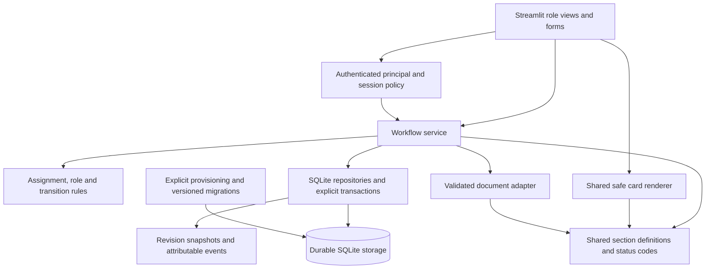

# Architecture recommendations

Audit date: 29 October 2026. These are proposed improvements only. The existing application and data were not modified. Findings and evidence are in [docs/audit/ISSUE_REGISTER.md](D:/hazem/projects/3S%20Security%20-%20job_describation%20-%202027/docs/audit/ISSUE_REGISTER.md); validation limits are in [docs/audit/PROJECT_AUDIT_REPORT.md](D:/hazem/projects/3S%20Security%20-%20job_describation%20-%202027/docs/audit/PROJECT_AUDIT_REPORT.md).

## Preserve the current foundation

Keep Python, Streamlit, python-docx, openpyxl and SQLite for the initial internal single-instance product. The codebase is about 2,188 Python lines across five understandable modules. No measured workload justifies microservices or a frontend rewrite. SQL is mostly parameterized, escaped word diffs work, the current database passes integrity checks, all original DOCX files parse, and the exporter produces a reopenable Word file. These are valuable foundations.

Keep the current IDs and existing document/request/history records. Do not use fresh seeding, destructive schema resets or broad source restructuring as a repair strategy.

## Proposed incremental boundaries



The diagram names responsibilities, not mandatory new packages or services. Implement them with a few small local modules/functions as needed after behavioral tests. Keep one server process and one persistence authority initially.

## 1. Establish trusted identity and a single write policy

**Findings:** AUD-001–005, AUD-011, AUD-030/031.

Remove account impersonation and credential autofill from real-data operation. A separate sanitized demo may retain them only when it cannot access real records. Use one trusted principal containing immutable user ID, role, active state and scope; do not pass full_name as authority.

Require every sensitive operation to validate the actor in the workflow service. Company directory visibility can remain broad; approval and amendment authority should be explicit. Preserve an executive cross-company permission if confirmed by the owner rather than giving it to every manager. The normal UI is not a separate security boundary from backend operations.

Authentication options:

| Option | Benefits | Trade-offs / prerequisites |
|---|---|---|
| Existing organization identity provider | Managed password/MFA/account lifecycle, fewer custom security responsibilities | Requires confirmed provider, connection and deployment configuration; not present now |
| Hardened local accounts | Fits current deployment without external dependency | Requires password hashing/reset, throttling, disable/revoke checks and administration to be implemented and maintained |

Do not choose a provider or add packages during this audit. Whichever approach is approved, migrate plaintext credentials without publishing them, invalidate demo defaults, and retain auditable user attribution. Remove password values from session payloads. Clear or namespace drafts when identities change and revalidate account state for writes.

**Acceptance:** employee-to-admin switching is impossible; unassigned managers cannot mutate unrelated JDs; explicitly granted executives retain authorized behavior; disabled/expired sessions cannot write; same-name users have distinct ownership.

## 2. Make review a conditional business transaction

**Findings:** AUD-005–010, AUD-012, AUD-028.

Use typed target identifiers such as JD field or responsibility field, with a shared whitelist. Do not infer target type from a numeric string or localized label.

Proposed acceptance sequence:

1. Begin a short transaction and resolve the authenticated actor.
2. Load the request and require a canonical pending state.
3. Resolve the target within its JD; require active/existing target and permitted field.
4. Compare the expected content revision to the live revision. A stale base is a conflict, not an implicit overwrite.
5. Change the target with a conditional revision check and require one affected row.
6. Advance the document revision for every field/child mutation; apply the agreed revision-bound approval rule.
7. Finalize the request conditionally and append an event using the actual pre-update value.
8. Commit all related changes together; on any failure, roll back and close the connection deterministically.

Illustrative invariants, not an executable migration:

```text
request.jd_id == target.jd_id
request.status == Pending before finalization
request.expected_revision == live_revision
one request decision -> at most one completed transition
content edit -> parent document revision advances
approved revision -> immutable content snapshot
audit.old_value == actual value immediately before committed write
```

For a modest SQLite workload, a short explicit write transaction and conditional updates are enough to start. A lock alone does not solve stale client data. Avoid network/file parsing work inside the transaction.

Product policy is needed for “approve as is with pending requests” and “does an accepted edit renew or invalidate approval?” Until explicitly defined, the safe proposed rule is to prevent ambiguous final approval and require an explicit approval of the new revision. Preserve current history; do not retroactively claim that old approvals bound to revisions if they did not.

**Trade-off:** conflict messages add a review step but prevent silent lost work. Conditional writes and snapshots add schema fields/storage; they avoid a much larger event-sourcing redesign.

**Acceptance:** replay, stale-base, cross-JD, missing-target and mid-transaction failure tests pass; responsibility and metadata edits advance one consistent document revision.

## 3. Unify the content model, safe UI and document formats

**Findings:** AUD-013–016, AUD-020, AUD-027, AUD-032/033.

Introduce one supported-section registry defining canonical key, Arabic label, target type, editability, display/export behavior and validation. Both role views and the parser/exporter should use it. Keep role-specific controls separate from the shared read-only card renderer.

Version supported DOCX layouts explicitly. Keep import provenance and diagnostics: original filename, safe content fingerprint, parser format version, completeness warnings and import actor/time. New upload should mean “new card” or “new revision” by explicit policy; filename alone is not a stable identity.

Separate extraction from normalization/validation. Dictionary mappings may normalize known labels but must not pretend to translate arbitrary prose. Unknown fields or missing safety data should stay unknown. Distinguish a finance guide from a standard JD if that is what the source document represents; do not force invented responsibilities into it.

Treat full-card views, editable field coverage, diff display and Word export as views of the same stored model. Escape dynamic HTML consistently. Preserve the existing word-diff escape behavior.

**Trade-offs:** stricter imports may reject documents previously accepted silently; provide a diagnostic draft flow so valid legacy documents are not lost. A shared registry must remain small and readable rather than becoming a generic form-builder framework.

**Acceptance:** export→parse preserves the approved supported field matrix, responsibility order and KPIs; both roles display populated competencies; drafts have truthful labels; repeated uploads do not silently create hidden duplicates.

## 4. Introduce a legacy-safe schema evolution path

**Findings:** AUD-010–012, AUD-019, AUD-023/024, AUD-029.

Use versioned, narrowly scoped migrations and explicit startup compatibility checks. The current DB has user_version=0 and mixed legacy English/Arabic values, so the first migration must inventory rather than assume cleanliness.

Recommended sequence:

1. Back up consistently and restore into an isolated test environment.
2. Add nullable actor IDs, canonical status/target fields and revision references without dropping legacy text.
3. Backfill observed statuses through an explicit mapping. Retain unknown states as unknown.
4. Backfill actor IDs only when the name match is unique; retain historical display labels.
5. Validate all rows, then add/rebuild constraints using a rehearsed SQLite migration strategy.
6. Enable FK enforcement on every connection; include relationship checks in deployment verification.
7. Add measured-use indexes, for example responsibilities by (jd_id, is_active, item_order), requests by status/time and JD, and audit rows by JD/time. Select final shapes using query plans and representative growth fixtures.
8. Keep rollback compatibility or a tested restore plan for every deployment step.

Do not manufacture unique job codes by overwriting empty fields during a schema upgrade without an approved identifier allocation policy. Do not erase existing duplicate imports automatically.

**Trade-off:** compatibility code temporarily reads both old and canonical values. That is safer than a one-step replacement that loses legacy history. No PostgreSQL schema work is required by the current evidence.

**Acceptance:** all IDs, record counts, text, historical attribution and files survive rehearsal; new constraints reject bad synthetic writes; old clients are blocked clearly or supported during the agreed rollout window.

## 5. Capture useful evidence without claiming absolute immutability

**Findings:** AUD-008/012/028.

Retain business audit events for import, request creation, accept/reject, unchanged approval, interview edits and account/assignment actions. Store stable actor IDs plus display-name snapshots, operation/request IDs, a consistent timezone-aware timestamp strategy, target and revision references, and actual old/new values where relevant.

Use UTC or offset-aware timestamps consistently, and display Africa/Cairo time for users. Current code mixes SQLite CURRENT_TIMESTAMP with naive datetime.now; this is a consistency risk to address as part of the same audit model, not evidence that existing times are already known to be incorrect.

Keep complete document snapshots per material revision if users need reliable historical reconstruction. Do not describe a local writable SQLite file as absolutely immutable. Application-level append-only permissions/triggers and independent protected backups improve assurance, but filesystem owners can still replace a local database. Stronger tamper-evidence or an external log is a later option only if the organization requires it.

**Acceptance:** a historical revision can be reconstructed; all relevant decisions have attributable events; failures roll back; no credentials or full document bodies enter operational error logs.

## 6. Make persistence and deployment explicit

**Findings:** AUD-021–024, AUD-029, AUD-035.

Externalize the database path and mount durable storage with a restricted application user. Keep real DB/source documents/workbooks out of public source and generic images; provide sanitized seed fixtures separately. Protect backup access and define retention, recovery point and recovery time objectives with the owner. Rehearse container replacement and restore before release.

Pin a supported Python/runtime/dependency set, with a reviewed lock and vulnerability scan. The local runtime is Python 3.14.5; Docker targets 3.11. Version compatibility must be demonstrated, not inferred from minimum constraints. CORS/XSRF/origin/host settings must be tested for the actual reverse proxy and deployment URLs. Use TLS at the chosen deployment boundary.

Separate liveness from readiness. The current Streamlit health endpoint is useful liveness evidence; validate schema/storage access with an additional safe application smoke check. Do not run seed jobs or write real rows as a health probe. Align port behavior with the hosting environment.

**Trade-offs:** durable SQLite is operationally simple for one instance but cannot be treated as a horizontal replica datastore. If a later measured workload needs multiple writers/HA, plan a separate data migration with reconciliation rather than changing platform preemptively.

## 7. Improve performance after correctness

**Findings:** AUD-026; dependent on AUD-008.

A local catalog query is already sub-millisecond median at the present size. First remove eager unrelated work: parse uploads on demand, reuse parsed previews safely, generate exports only when requested or by stable revision key, load bounded history and fetch catalogs once per relevant run.

Cache keys must include document revision and any actor/scope affecting visibility. Cache invalidation cannot rely on the current parent version until child-version behavior is repaired. Cache no password-bearing user records. Use conditional pages/navigation compatible with the locked Streamlit version rather than assuming newer tab APIs are supported by the current minimum version.

**Acceptance:** measure rerun time, database query count, DOCX creation count and memory on representative fixtures; set thresholds with owners before pursuing larger infrastructure.

## Recommended first architectural increment

Add synthetic regression coverage, fix the two demo access paths and credential handling, then route the existing review/approval UI through one validated transaction service. Next unify status/section definitions and repair document fidelity. This reduces the largest risks without moving existing screens or changing deployment technology at the same time.

