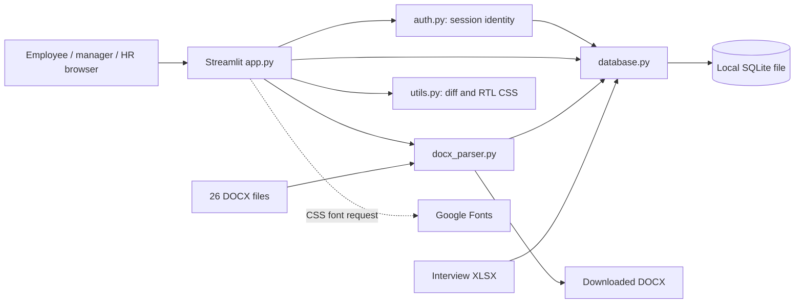

# Project audit report

Audit date: **29 October 2026**, Africa/Cairo. Project: **3S Security Arabic Job Description Governance Portal — 2027**. Assessment is of the supplied local snapshot, not a verified production deployment.

## Decision and scope

**Not ready for production use with real employee data.** The project is a useful, compact working prototype, but it has direct account impersonation paths, weak credential handling, inconsistent approval integrity and lossy document interchange. Preserve the Streamlit/Python/SQLite foundation and improve it incrementally. A rewrite, separate SPA, microservices or immediate database-platform migration is not justified by this evidence.

The consolidated register contains **35 findings: 2 Critical, 18 High, 14 Medium and 1 Low**. Severity describes impact; implementation priority is independently assigned. See [docs/audit/ISSUE_REGISTER.md](D:/hazem/projects/3S%20Security%20-%20job_describation%20-%202027/docs/audit/ISSUE_REGISTER.md) for every finding’s exact location, root cause, impact, fix, effort and verification.

All five Python modules, every supplied configuration/deployment file, README, all 26 Word source files, workbook structure/seed eligibility, database schema/indexes and aggregate data integrity were inspected. Existing database access used a SQLite URI with **mode=ro**. Mutation probes ran on separate shared **in-memory databases containing synthetic records**, using the real application functions. The application’s production startup/seed path was never invoked against the existing database. No dependencies were installed. No source or existing data was changed. Only the seven Markdown reports in docs/audit were added.

## 1. Project discovery and current purpose

The intended workflow is documented in [README.md:14](D:/hazem/projects/3S%20Security%20-%20job_describation%20-%202027/README.md:14):

1. An employee or department manager reviews a job card, approves it unchanged, or proposes a clause amendment with a justification.
2. HR compares old/proposed text, accepts or rejects the amendment and records comments.
3. HR imports additional Word cards, examines history and maintains interview outcomes.
4. Staff browse a company directory and download an Arabic Word document.

The application implements a Streamlit server-rendered UI and Python functions in one process. There is no independent REST/GraphQL backend, JavaScript application, API gateway, queue, external identity provider or managed database integration in this snapshot. SQL access is local. “Backend API” assessment therefore concerns Python service/persistence boundaries and Streamlit action handlers, not nonexistent HTTP endpoints.

### Inventory

| Asset | Observed implementation |
|---|---|
| [app.py](D:/hazem/projects/3S%20Security%20-%20job_describation%20-%202027/app.py) | 785 lines; login landing page, admin tabs, employee/manager tabs, review/import/export/schedule workflows |
| [auth.py](D:/hazem/projects/3S%20Security%20-%20job_describation%20-%202027/auth.py) | 126 lines; custom plaintext login, session state, demo credentials and unrestricted account switcher |
| [database.py](D:/hazem/projects/3S%20Security%20-%20job_describation%20-%202027/database.py) | 684 lines; schema, bootstrap, translation lookups, CRUD, review, approval and statistics |
| [docx_parser.py](D:/hazem/projects/3S%20Security%20-%20job_describation%20-%202027/docx_parser.py) | 344 lines; table-oriented parser and Arabic Word exporter |
| [utils.py](D:/hazem/projects/3S%20Security%20-%20job_describation%20-%202027/utils.py) | 249 lines; escaped word diff, broad RTL CSS, Arabic-character helper |
| [requirements.txt](D:/hazem/projects/3S%20Security%20-%20job_describation%20-%202027/requirements.txt) | Four minimum-only dependencies: Streamlit, python-docx, pandas, openpyxl |
| [.streamlit/config.toml](D:/hazem/projects/3S%20Security%20-%20job_describation%20-%202027/.streamlit/config.toml) | Light theme, headless mode, CORS off, XSRF on, port 8501 |
| [Dockerfile](D:/hazem/projects/3S%20Security%20-%20job_describation%20-%202027/Dockerfile) | Python 3.11 slim, pip install, complete directory copy, Streamlit listener/health check |
| job describation/ | 26 source DOCX files, all parsed without exceptions |
| Root XLSX | Two sheets; dimensions 12×8 and 8×4; 9 rows eligible for current interview seeding |
| job_descriptions.db | 368,640 bytes; 6 application tables plus sqlite_sequence |
| Documentation/configuration | README only before audit; no tests, CI, schema migration tool, lockfile, .gitignore or deployment-volume manifest found |
| Existing bytecode | Five Python 3.14 cache files; treated as generated artifacts, not application source |

No AGENTS.md was found in the workspace or checked parent chain. No Git metadata was present in the supplied project, so commit history, tracked-file status, branch policy and remote exposure could not be assessed.

### Technologies actually available during validation

| Component | Installed local version | Manifest/container qualification |
|---|---|---|
| Python | 3.14.5 | Docker targets Python 3.11; container behavior was not verified |
| Streamlit | 1.66.1 | Manifest permits 1.35.0 and newer |
| python-docx | 1.2.0 | Manifest permits 1.1.0 and newer |
| pandas | 3.0.3 | Manifest permits 2.0.0 and newer |
| openpyxl | 3.1.5 | Manifest permits 3.1.0 and newer |
| pytest | 9.1.1, available in host | Not supplied as a project test dependency |
| pip-audit | Not installed | No full vulnerability scan claimed |
| Docker | Not found on PATH | No image build or container smoke test performed |

### Relationships



The font is the only externally referenced runtime presentation service found. File parsing and dictionary-based label translation occur locally. There is no general-purpose translation service; arbitrary uploaded prose is not automatically translated by this implementation.

### Database map and observed state

| Table | Rows | Responsibility and relationships |
|---|---:|---|
| users | 15 | Username unique; role, department, optional assigned_jd_id; assignment has no FK |
| job_descriptions | 26 | Card metadata, content, status and version |
| accountabilities | 399 | Child responsibility text/KPI, order, version and active flag; declared JD FK |
| modification_requests | 1 | Proposed change, original-text snapshot, justification, requester/reviewer names and status; declared JD FK |
| jd_audit_trail | 28 | Event text and actor label; declared JD FK; mod_request_id has no FK |
| interview_schedule | 9 | Imported meeting data and editable outcome/status; independent of JD/user IDs |

SQLite integrity_check returned **ok**. foreign_key_check returned **0 violations**. There were **0 dangling non-null user assignments**, **0 duplicate user full-name groups**, and **0 duplicate title/department groups** in the supplied data. These observations are positive snapshot results, not proof that future writes are constrained.

25 cards are under review and 1 is approved. The one request stores the legacy English state **Accepted**. The 28 history actions use English legacy labels: 26 Initial Import, 1 Approved As Is and 1 Modification Accepted. Current mutation code writes Arabic labels. PRAGMA user_version is 0; journal mode is delete. Only the users.username autoindex exists; the other application tables have no secondary indexes.

Data completeness counts:

| Field or condition | Empty/absent among 26 cards |
|---|---:|
| Job code | 26 |
| Competencies | 26 |
| Purpose | 0 |
| Dimensions | 0 |
| Frameworks/authority | 3 |
| Qualifications | 1 |
| Hazards | 4 |
| Safe practices | 4 |
| Internal relations | 2 |
| External relations | 4 |
| Stored approvals | 1 |
| No responsibilities | 1 |

Empty fields are observations, not automatic defects in source extraction or invented requirements. The confirmed problem is that missing fields can be hidden or replaced with authoritative defaults (AUD-032), and accepted competency content has no full-card/export representation (AUD-015).

## 2. Architecture and maintainability

Useful separation exists among UI, authentication, persistence, parsing and presentation. Dependencies are few and sensible for a small internal review portal. Parameterized SQL is widely used, and the one dynamic update column comes from a fixed field whitelist ([database.py:527](D:/hazem/projects/3S%20Security%20-%20job_describation%20-%202027/database.py:527)); no confirmed SQL injection was identified in these paths.

The boundaries are incomplete. database.py combines schema creation, seed provisioning, content mapping, repositories and business transactions. app.py combines navigation, authorization decisions, form state, file processing and duplicated card presentation. Actor identity is passed as editable-looking strings rather than a trusted principal. The central missing abstraction is a small **workflow service** enforcing actor scope, typed targets, lifecycle transitions and atomic revisions (AUD-004–AUD-012).

SOLID/Clean Architecture are useful selectively: extract narrow services and shared field definitions without introducing a generic repository framework, dependency-injection platform or network boundary. Keep a modular monolith. State remains in Streamlit session state, but account transitions and record-specific drafts need defined ownership/freshness (AUD-031). Raw state should not be treated as an indefinitely valid authorization decision.

Schema initialization on every script rerun and JD-count-gated provisioning make partial startup fragile (AUD-029). Use explicit, versioned bootstrap and migrations, with fixture-only tests and a restore-first rollout.

## 3. Backend, transactions and business correctness

Existing valid field updates, request creation, imports, unchanged approval and interview writes have real implementations; these are not mock buttons. The review function usually commits request status, target edit and acceptance event together on its normal path. That existing transaction grouping should be preserved.

The missing preconditions are consequential:

- AUD-006: finalized requests are not protected from replay or decision reversal.
- AUD-007: original text/version is not checked against the current target; old text in the audit row can be stale.
- AUD-005: a numeric clause ID can address a responsibility outside the request’s JD.
- AUD-008: child edits leave the document version unchanged; approved content can change without approval being rebound to a revision.
- AUD-009: unknown sections and missing targets can produce success/audit events without a valid content change.
- AUD-010: application-only form checks do not protect other callers or database writes.
- AUD-028: failures do not have explicit rollback/close guarantees or consistent safe error messages.

These are reproduced sequentially using real functions; no simultaneous-writer experiment was executed. The same absent conditional transitions create a concurrency risk, but measured race frequency is unknown. SQLite is suitable for a modest single-instance workload once invariants and transaction ownership are fixed. Multiple writable replicas over separate local database files would not represent one consistent service.

No background work or third-party network integration exists to assess for queue retries, webhook signatures or outbound API contracts. File ingestion is the material integration boundary.

## 4. Frontend, workflow and UX

The product has a coherent Arabic vocabulary, role-oriented tabs, an intentional RTL theme, clear before/after comparison, empty-request messages and several input checks. Staff-directory visibility supports the documented coordination purpose and should not be removed as an automatic security fix.

Code-supported issues include:

- AUD-017: interview edit fields are not populated from the selected record; saving replaces stored notes/status.
- AUD-018: an empty catalog or broken assignment has no safe journey.
- AUD-019: the observed Accepted state is styled as under review.
- AUD-015/AUD-033: competency content is absent from full views; KPI and other section editing is incomplete.
- AUD-032: identical fallback identifiers, invented office-safety text and approved headings on draft exports misrepresent card readiness.
- AUD-027: duplicate presentation and broad CSS create drift across roles and framework upgrades.
- AUD-034: the stored meeting-time field is omitted from the interview table.
- AUD-031: authentication changes do not clear or isolate unrelated session state.

Success messages immediately followed by rerun, long expanded request lists, six dense admin tabs and two-column comparisons deserve moderated usability validation; they are recommendations, not measured defects. Static CSS inspection cannot establish mobile breakpoints, focus order, screen-reader reading order, color contrast, browser sanitization or Arabic Word print quality. Those areas remain unassessed. See [docs/audit/UI_UX_IMPROVEMENT_PLAN.md](D:/hazem/projects/3S%20Security%20-%20job_describation%20-%202027/docs/audit/UI_UX_IMPROVEMENT_PLAN.md) for acceptance tasks.

## 5. Word import/export and feature completeness

All 26 original source files parsed successfully in **0.415 seconds total** on this host. That confirms parser execution, not semantic extraction accuracy for every source cell. One source fixture has zero extracted responsibilities, and all have empty extracted job codes and competencies. The nonstandard finance guide may need explicit document-type treatment rather than assuming every file must have identical sections.

The exporter returns an in-memory valid DOCX that python-docx can reopen. It sets RTL paragraphs and styles tables, preserving a useful output foundation. However:

- The parser expects purpose in a table while export uses a paragraph (AUD-014).
- Responsibility table detection/column assumptions differ between the two formats; the synthetic round trip produced zero responsibilities.
- Competencies and stored approvals are omitted from export (AUD-015).
- Incomplete/unrelated DOCX content has no business validation gate (AUD-016).
- “Create or update” always inserts, and duplicate selector labels collapse IDs (AUD-013).
- Static approved wording and fallback facts conflict with real document state (AUD-032).

| Workflow | Assessment | Evidence/limit |
|---|---|---|
| Credential login | Implemented, unsafe | Plain comparison, demo credentials and impersonation |
| Staff card display | Implemented, partial | Main sections render; competency omission and empty-assignment paths |
| Company directory | Implemented | Metadata table; manager mutation scope needs restriction |
| Submit text/responsibility request | Implemented, partial | Basic form checks; missing target/version/service validation and KPI edits |
| HR visual review | Implemented, unsafe decision semantics | Escaped word diff is good; side panels are raw HTML; replay/conflict defects |
| Approve unchanged | Implemented, incomplete governance | Writes status/history; no revision-bound or pending-change checks |
| Track own requests | Implemented, fragile | Ownership uses full_name; legacy status mismatch |
| Word import | Executed on all source files; partial validity | Preview/insertion real; duplicate/validation/template risks |
| Word export | Valid DOCX generation; incomplete fidelity | Missing stored fields, failed self-round-trip |
| History | Implemented, incomplete guarantee | Acceptance/import/approval rows; no full revision reconstruction or rejection/schedule events |
| Interview outcomes | Implemented, unsafe form defaults | 9 imported rows; overwrite risk and missing displayed time |
| Account lifecycle | Missing production capability | No supported provisioning, reset, disable or assignment editor |
| Backup/restore/migrations/CI | Missing supplied operational capability | No scripts/runbooks/configuration for these controls |

Missing account administration and future notifications are production-readiness recommendations, not invented original acceptance criteria. No claim is made that every visually present workflow is complete or production-tested.

## 6. Security

**Critical:** AUD-001 and AUD-002 remove meaningful role boundaries in the unchanged demo configuration. **High:** plaintext credentials (AUD-003), unconstrained manager/service writes (AUD-004/005), CORS off (AUD-021), mutable-data deployment practices (AUD-023) and unbounded dependency ranges (AUD-024). Review/data-integrity defects are also security-relevant where they enable unauthorized or misattributed changes.

Stored text enters raw HTML without consistent escaping (AUD-020). This confirms markup interpretation risk; it does **not** prove arbitrary JavaScript execution. The escaped diff helper is a positive counterexample and should be reused.

Upload type filtering and exception handling exist, but document-specific size/decompression/structure budgets do not (AUD-022). No attack payload was executed. There is no app-level login rate limiter or security event log. Authentication uses Streamlit session state rather than explicit app-issued JWTs; no token signing/rotation or custom cookie implementation was found. Transport TLS, reverse-proxy rules, filesystem permissions, network exposure and actual backup access were not inspectable.

The installed Streamlit configuration was checked: enableCORS=false remains effective with enableXsrfProtection=true in version 1.66.1. Do not assume XSRF silently restores CORS. This agrees with [official configuration documentation](https://docs.streamlit.io/develop/api-reference/configuration/config.toml).

The manifest permits older Windows runtimes covered by [GHSA-7p48-42j8-8846](https://github.com/streamlit/streamlit/security/advisories/GHSA-7p48-42j8-8846) (fixed in 1.54.0) and [GHSA-rxff-vr5r-8cj5](https://github.com/streamlit/streamlit/security/advisories/GHSA-rxff-vr5r-8cj5) (fixed in 1.37.0; static-file sharing is a condition). The installed 1.66.1 version is outside both affected ranges. This is a **permitted-version risk**, not a confirmed dependency vulnerability in this environment. The Docker target is Linux, so Windows-specific advisories do not directly establish vulnerability of that image. A complete transitive/container scan remains outstanding.

No credentials, token values, passwords, private keys, individual names or row-level business text are reproduced in these reports.

## 7. Database integrity, migration and recovery

The supplied file is structurally healthy today. It is not protected against all invalid future writes. Enable foreign keys on each connection; [SQLite documents this as a per-connection requirement](https://www.sqlite.org/foreignkeys.html). Add actor relationships, typed domain values and constraints only after read-only legacy-data analysis.

Migration constraints for every proposed change:

1. Take and verify a consistent protected backup before implementation; rehearse restore on an isolated copy.
2. Preserve current primary keys, requests, audit rows, source provenance and original text.
3. Introduce nullable canonical fields/actor IDs and a schema version first; map observed English/Arabic values explicitly.
4. Backfill only unambiguous identities; flag unknown status/actor/target values rather than guessing.
5. Validate counts, relationship checks, full document values and original file hashes on a copy.
6. Add constraints/indexes in a controlled migration, with an application compatibility window and tested rollback/restore path.
7. Make startup validate schema readiness rather than silently importing accounts/content.
8. Never reset/reseed an existing deployment to “fix” missing data.

Retention periods, RPO/RTO and approval authority require an accountable business owner. They are not inferred from source code. The current schema records only portions of revision history, so backups protect existing evidence but cannot recreate data that was never captured.

## 8. Performance and scalability

Measured read-only query: the catalog SQL shape from get_all_jds against 26 JDs, 399 responsibilities and 1 request ran **25 times, median 0.705 ms, maximum 2.643 ms** on a warm local connection. A semantically equivalent IN predicate was used for pending-status matching. EXPLAIN showed a JD scan, two correlated child scans and a temporary sort. This is not an application latency/load benchmark.

Corpus parsing: 26 documents, 0 exceptions, 0.415 seconds total. The largest source archive expands to 497,826 bytes. These small supplied fixtures do not establish behavior at the effective upload limit of 200 MB per file.

Potential growth costs (AUD-026): all default tab content executes, retained uploads are reparsed on rerun, Word output is generated eagerly, full history/pending queues load without pagination, and catalogs are queried more than once in an admin run. [Streamlit documents eager default tab computation](https://docs.streamlit.io/develop/api-reference/layout/st.tabs). Any later use of newer conditional-tab APIs must be compatible with the chosen locked Streamlit version.

There is no measured justification for a cache cluster, queue, search engine or Postgres migration. Start with selective indexes based on query plans, bounded retrieval, conditional navigation and revision-aware caches after fixing revision integrity. Keep SQLite single-instance with durable storage until measured contention or availability requirements justify moving.

## 9. Validation ledger

“Observed defect” means the current unsafe behavior was reproduced; it is not a passing product acceptance test. All mutation fixtures were synthetic, in memory, and disconnected from the supplied DB.

| ID | Execution | Result |
|---|---|---|
| T01 | ast.parse of every source module | 5/5 parsed successfully; no bytecode written |
| T02 | python -B -m pip check | Exit 0: No broken requirements found; not a security scan |
| T03 | Read-only DB integrity/FK/index/domain inventory; memory connection default check | integrity ok, 0 declared-FK violations, application connection pattern leaves foreign_keys=0 |
| T04 | Real auth.render_auth_sidebar and logout with synthetic Streamlit adapter/users | Employee became admin without password; unrelated draft state survived switch/logout; no browser run claimed |
| T05 | Accept the same synthetic request twice | Both calls successful; version 3; two audit rows — observed defect |
| T06 | Accept two requests based on one original value | Second overwrote first; audit old_text remained stale — observed defect |
| T07 | JD 1 request referencing JD 2 responsibility | Other JD responsibility changed; parent JD version stayed 1 — observed defect |
| T08 | Approve JD, then accept field edit | Content changed; JD still marked approved, version 2 — observed behavior needing revision policy |
| T09 | Accept unsupported section | Success and audit row with unchanged purpose — observed defect |
| T10 | Import same synthetic parsed data/file twice | Two distinct IDs and two copies — observed behavior without duplicate policy |
| T11 | Reject synthetic request | Zero jd_audit_trail rows — observed coverage gap |
| T12 | Word diff containing an HTML img tag | Raw tag escaped; positive helper check |
| T13 | Parse all 26 original DOCX files | 26 successful; 0 exceptions; 1 without responsibilities; 26 without code/competencies |
| T14 | Export synthetic sentinel fields and reopen/reparse bytes | Valid DOCX; competency/approval sentinels absent; title retained; purpose/responsibility round trip failed |
| T15 | EXPLAIN + 25 local catalog reads | Scans observed; median 0.705 ms, maximum 2.643 ms |
| T16 | PYTEST_DISABLE_PLUGIN_AUTOLOAD=1; python -B -m pytest --collect-only -p no:cacheprovider -q | No tests collected in 0.01 s; nonzero result, not “tests pass” |
| T17 | Installed Streamlit config read | CORS false, XSRF true, per-file upload limit 200 MB |
| T18 | Synthetic bootstrap interruption, orphan/empty request, nonexistent approval and unrelated DOCX probes | Partial bootstrap not repaired; orphan/empty request accepted; nonexistent approval logged; unrelated DOCX given importable shape |
| T19 | Streamlit AppTest attempt | No successful UI run: Windows asyncio local socket setup hung in socketpair/accept under sandbox; attempts stopped. A minimal from_string probe also hit denied temporary-file access. Not an application failure finding |
| T20 | SHA-256 comparison of all 43 original files after report creation | See final preservation statement below |

The first aggregate-data command encountered a Windows stdout encoding error when printing Arabic statuses. It was rerun with UTF-8 output and completed. A supplementary installed-internal-module import was unavailable; effective configuration itself was read successfully. Neither limitation invalidates the successful source/function/data checks.

### Reproduce representative integrity observations safely

Use a disposable workspace and the existing Python dependencies. The following illustrative harness uses only read-only schema access plus synthetic memory databases; it does not call init_db or touch existing rows. It captures the same operations used for the corresponding probes. Keep the keeper connection alive while functions open their own memory connections.

```python
import pathlib, sqlite3
import database

source = sqlite3.connect(
    pathlib.Path("job_descriptions.db").resolve().as_uri() + "?mode=ro",
    uri=True,
)
schema = [row[0] for row in source.execute(
    "SELECT sql FROM sqlite_master "
    "WHERE type='table' AND name NOT LIKE 'sqlite_%'"
)]
source.close()
keeper = sqlite3.connect("file:audit_repro?mode=memory&cache=shared", uri=True)
for ddl in schema:
    keeper.execute(ddl)
for n in (1, 2):
    keeper.execute(
        "INSERT INTO job_descriptions(id,title,purpose) VALUES (?,?,?)",
        (n, "Synthetic card", "Original"),
    )
    keeper.execute(
        "INSERT INTO accountabilities(id,jd_id,item_order,description) "
        "VALUES (?,?,1,?)", (n, n, "Original clause"),
    )
keeper.commit()

def memory_connection():
    conn = sqlite3.connect("file:audit_repro?mode=memory&cache=shared", uri=True)
    conn.row_factory = sqlite3.Row
    return conn

original_connection = database.get_connection
database.get_connection = memory_connection
try:
    request_id = database.submit_modification_request(
        1, "Job Purpose", "purpose", "Original", "Synthetic changed",
        "Synthetic reason", "Synthetic actor",
    )
    database.review_modification_request(request_id, "Accept", "", "Synthetic HR")
    database.review_modification_request(request_id, "Accept", "", "Synthetic HR")
    assert keeper.execute(
        "SELECT version FROM job_descriptions WHERE id=1"
    ).fetchone()[0] == 3  # Reproduces the current defect, not desired behavior.

    request_id = database.submit_modification_request(
        1, "Accountability", "2", "Original clause", "Cross-target changed",
        "Synthetic reason", "Synthetic actor",
    )
    database.review_modification_request(request_id, "Accept", "", "Synthetic HR")
    assert keeper.execute(
        "SELECT description FROM accountabilities WHERE id=2"
    ).fetchone()[0] == "Cross-target changed"
finally:
    database.get_connection = original_connection
    keeper.close()
```

## 10. Health scores

Scores are evidence-based engineering judgments, not certification or percent completion. Bands: 0–19 fundamental controls absent/bypassed; 20–39 functional prototype with serious correctness gaps; 40–59 partial implementation needing substantial hardening; 60–79 controlled pilot quality; 80–100 verified production controls. The assessment does not award points merely because a feature directory exists.

| Category | Score /100 | Base weight | Rationale |
|---|---:|---:|---|
| Architecture | 55 | 10% | Simple module boundaries and appropriate stack; bootstrap/workflow/presentation are coupled |
| Backend | 35 | 15% | Real CRUD/transactions; reproduced replay, stale overwrite and invalid-target behavior |
| Frontend | 50 | 10% | Coherent role pages/forms; missing fields, status mismatch and unsafe empty states; browser rendering unverified |
| UI/UX | Not Assessed | 10% | Source-level journey findings documented; no rendered/mobile/accessibility/user session completed |
| Database | 40 | 15% | Healthy current file and logical child tables; disabled enforcement, weak domain/identity/version history and no migrations |
| Security | 10 | 15% | Two direct demo access paths plus plaintext credentials; parameterized SQL and escaped diff are strengths |
| Performance | Not Assessed | 5% | Only local query/corpus microbenchmarks; no end-to-end latency, memory or concurrent-user measurement |
| Testing | 10 | 10% | Syntax/dependency checks succeed; no supplied tests or CI, multiple defects reproduced |
| Maintainability | 45 | 5% | Small readable Python footprint; duplicate rendering/field maps, unbounded dependencies and no executable guardrails |
| Feature Completeness | 55 | 5% | Core workflows implemented; document fidelity, history guarantees and administration incomplete |

Assessed base weight = **85%**. Weighted numerator = 55×10 + 35×15 + 50×10 + 40×15 + 10×15 + 10×10 + 45×5 + 55×5 = **2,925**.

**Overall assessed project health = 2,925 ÷ 85 = 34.4/100.** Unassessed categories are excluded and weights renormalized; they are neither zero nor assumed healthy. A good weighted average would not override an unresolved critical access defect.

## 11. Readiness gates and next steps

- Gate 1: remove impersonation/embedded credentials; migrate authentication safely; prove negative authorization and session checks.
- Gate 2: reproduce then fix review invariants, assignment scope, parent revisions, target validation, audit accuracy and interview preservation.
- Gate 3: preserve all required content across source parsing, UI and export, with truthful missing/draft indicators.
- Gate 4: rehearse legacy-safe migration, durable storage, backup/restore and supported locked deployment.
- Gate 5: run automated synthetic regression/CI plus browser/RTL/mobile/accessibility and target-container verification; set measured performance targets.

See [docs/audit/DEVELOPMENT_ROADMAP.md](D:/hazem/projects/3S%20Security%20-%20job_describation%20-%202027/docs/audit/DEVELOPMENT_ROADMAP.md) for dependencies, stage risks, owners, benefits and acceptance criteria. No fixed release date or “percentage ready” is defensible from this snapshot. Stage 1 is a prerequisite for a controlled pilot; real production readiness requires all applicable gates and business sign-off on authority/retention rules.

## 12. Explicit limitations

Not performed: production access, external penetration testing, browser rendering or screenshots, screen-reader/mobile/keyboard tests, document print rendering in Word, simultaneous concurrency/load tests, outbound integration testing, container build, dependency resolution in a clean Python 3.11 environment, complete transitive/container CVE scan, operating-system hardening review, deployment backup restore or migration execution.

No assumptions are made about controls outside this workspace. Recommendations concerning persistent storage, account lifecycle, retention and tamper resistance are readiness requirements to validate with the owner, not claims that a known live service already lost data.

Preservation verification: **43/43 pre-existing file hashes matched after creation of the seven audit reports; no original file was added to, removed, renamed or changed.** The database SHA-256 remained b76e40ff7cc0d9f42bdc4b02c7fb0eb7c1275d593ec10bc63253dc6d481e7313. This statement was checked during final validation; reports contain no application fixes.

